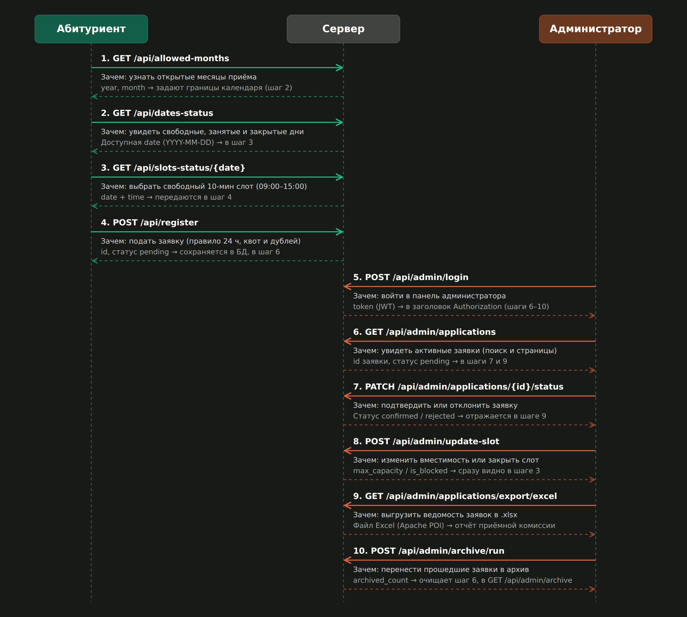
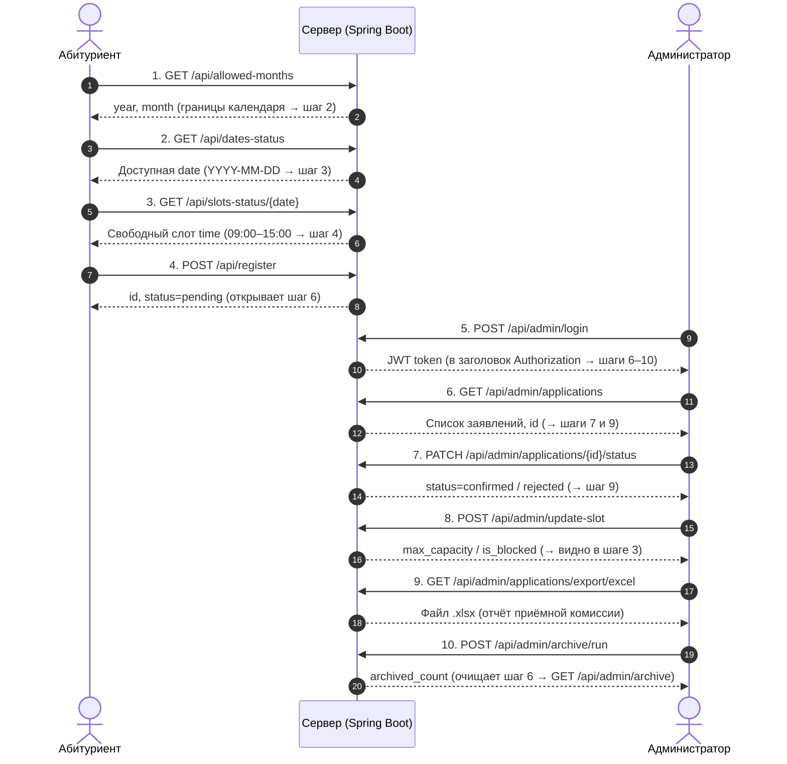

# Лабораторная работа: Диаграмма последовательностей API

**Проект:** Автоматизированная система приёмной комиссии колледжа (Java 21 + Spring Boot 3)  
**Участники (роли):** `Абитуриент` (публичный доступ), `Сервер` (Spring Boot REST API), `Администратор` (JWT `ROLE_ADMIN`)

---

## 1. Визуальная диаграмма

*(Исходник диаграммы: [`api-sequence-diagram.html`](api-sequence-diagram.html))*

---

## 2. Пошаговая логика и связи между эндпоинтами

| Шаг | Кто вызывает | Эндпоинт | Зачем нужен | Что передаёт дальше |
| :-: | :--- | :--- | :--- | :--- |
| **1** | Абитуриент | `GET /api/allowed-months` | Узнать разрешённые месяцы кампании | `year, month` → границы календаря (шаг 2) |
| **2** | Абитуриент | `GET /api/dates-status` | Увидеть заблокированные, заполненные дни и открытые выходные | Выбранная `date` (`YYYY-MM-DD`) → в шаг 3 |
| **3** | Абитуриент | `GET /api/slots-status/{date}` | Получить 37 слотов (`09:00–15:00`) и свободные места | Пара `date + time` → в шаг 4 |
| **4** | Абитуриент | `POST /api/register` | Записаться на приём (проверка 24 ч, квоты, дублей) | `id`, статус `pending` → сохраняется в БД (шаг 6) |
| **5** | Администратор | `POST /api/admin/login` | Войти в систему по логину/паролю | `token` (JWT) → в заголовок `Authorization: Bearer ...` (шаги 6–10) |
| **6** | Администратор | `GET /api/admin/applications` | Просмотреть реестр заявлений (поиск, сортировка, страницы) | `id` заявки → в шаг 7 (и удаление `DELETE`) |
| **7** | Администратор | `PATCH /api/admin/applications/{id}/status` | Перевести статус в `confirmed` или `rejected` | Подтверждённый статус → попадает в шаг 9 |
| **8** | Администратор | `POST /api/admin/update-slot` | Изменить `max_capacity` или заблокировать слот | Обновлённая квота → сразу видна абитуриенту в шаге 3 |
| **9** | Администратор | `GET /api/admin/applications/export/excel` | Сформировать ведомость в формате `.xlsx` (Apache POI) | Готовый Excel-файл для комиссии |
| **10** | Администратор | `POST /api/admin/archive/run` | Перенести прошедшие заявки в архивную таблицу *(также авто каждые 5 мин)* | `archived_count` → очищает шаг 6 и открывает `GET /api/admin/archive` |

---

## 3. Полная карта дополнительных административных эндпоинтов (влияющих на шаги 1–3)

Все маршруты ниже требуют JWT-токен из **шага 5** и напрямую управляют календарём, который видит абитуриент на **шагах 1–3**:

- **Управление месяцами (влияет на шаг 1):**
  - `GET /api/admin/allowed-months` — список открытых месяцев.
  - `POST /api/admin/add-month` — открыть новый месяц приёма.
  - `POST /api/admin/remove-month` — закрыть месяц приёма.
- **Управление днями и лимитами (влияет на шаг 2 и шаг 4):**
  - `GET /api/admin/blocked-dates` — список заблокированных дат и открытых выходных.
  - `POST /api/admin/toggle-date` — заблокировать или разблокировать рабочий день.
  - `POST /api/admin/toggle-weekend` — открыть или закрыть субботу/воскресенье для приёма.
  - `GET /api/admin/daily-limit/{date}` и `POST /api/admin/daily-limit` — просмотр и установка суточного лимита заявок.
- **Детали слотов, настройки и очистка:**
  - `GET /api/admin/slot-configs/{date}` — точечные настройки вместимости слотов на дату (перед **шагом 8**).
  - `GET /api/admin/settings` и `POST /api/admin/settings` — чтение и изменение `advance_hours` (минимум часов до визита, используется в **шагах 2 и 4**).
  - `DELETE /api/admin/applications/{id}` — удаление ошибочной заявки по `id` из **шага 6**.
  - `GET /api/admin/archive` — просмотр архива заявок после **шага 10**.

---

## 4. Mermaid-код диаграммы (если понадобится вставить в отчёт текстом)

